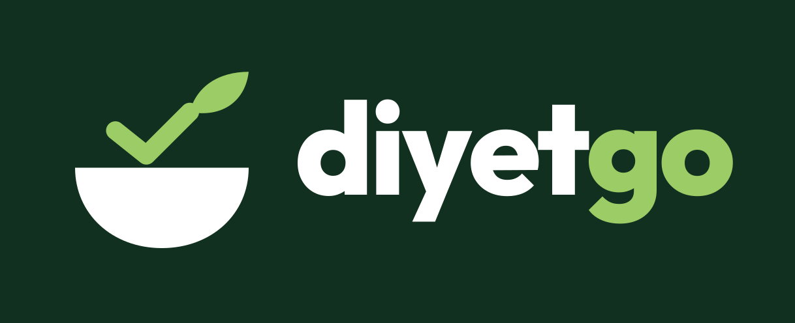

# Diyetgo

<p align="center"></p>

Diyetisyenler için danışan, ölçüm, besin, beslenme planı, randevu ve beslenme hedefi yönetimi sunan bir web uygulaması.

> **Demo uyarısı:** Herkese açık sürüm (Vercel) yalnızca **demo modunda** çalışır; yerel PostgreSQL modu için bkz. [Yerel veritabanı ve backend](#yerel-veritabanı-ve-backend). Demo modunda tüm veriler **yalnızca kullandığınız tarayıcıda** (localStorage) tutulur; sunucuya gönderilmez, cihazlar arasında paylaşılmaz ve yedeklenmez. Örnek veriler **kurgusaldır**. **Gerçek kişisel veya sağlık verisi girmeyin.**

## İçindekiler

- [Özellikler](#özellikler)
- [Gereksinimler](#gereksinimler)
- [Kurulum ve çalıştırma](#kurulum-ve-çalıştırma)
- [Komutlar](#komutlar)
- [Ortam değişkenleri](#ortam-değişkenleri)
- [Yerel veritabanı ve backend](#yerel-veritabanı-ve-backend)
- [Demo modu](#demo-modu)
- [Mobil uygulama (PWA)](#mobil-uygulama-pwa)
- [Hesaplamalar ve sınırları](#hesaplamalar-ve-sınırları)
- [Proje yapısı](#proje-yapısı)
- [Durum ve planlanan işler](#durum-ve-planlanan-işler)

## Özellikler

- **Genel bakış:** Aktif danışan, bugünkü ve yaklaşan randevu, aktif plan özetleri; bugünün zaman çizelgesi ve son işlemler.
- **Danışanlar:** Ekleme, düzenleme, arama, arşivleme; ilişkili kaydı olmayan danışanı silme.
- **Ölçümler:** Boy, kilo, bel, kalça, uyluk (bacak) çevresi ve vücut yağ oranı; kilo değişim grafiği.
- **Sağlık bilgileri ve öneriler:** Danışanın kullandığı ilaç ve takviyeler, hastalıkları ve diyetisyenin tarihli önerileri. Kayıt amaçlıdır; uygulama ilaç etkileşimi veya tedavi önerisi üretmez.
- **Haftalık rapor:** Danışan detayından, danışana gönderilecek görsel bir özet (kilo grafiği ve değişimi, vücut ölçüleri, planın haftalık kalori ve makro ortalaması, sonraki randevu, diyetisyen notu). PNG olarak indirilir; telefonda doğrudan paylaşılabilir. Rapor kaydedilmez, her seferinde güncel veriden üretilir.
- **Besinler ve tarifler:** 100 g veya 100 ml başına enerji ve makro değerleri, porsiyon bilgisi, hazırlama yöntemi (çiğ, haşlama, ızgara, fırın, kızartma vb.), arşivleme. Tarif / yemek, malzemeleri (besin + miktar) ve pişmiş toplam ağırlığıyla girilir; 100 g değeri malzemelerden hesaplanır ve plana besin gibi eklenir.
- **Beslenme planları:** İki tür plan vardır, tür plan oluşturulurken seçilir:
  - *Günlük menü:* Göreli günler (1. gün = başlangıç tarihi), öğünler, porsiyonlar; günlük, öğün ve haftalık toplamlar.
  - *Seçenekli haftalık menü:* Her öğün türü için birkaç seçenek ve haftalık adet girilir (ör. haftada 3 kahvaltı, 4 ara öğün); danışan seçeneklerden birini seçer. Haftalık değerler, en düşük ve en yüksek kalorili seçeneklere göre aralık ve ortalama olarak gösterilir. API'de `kind: "options"` ve `weeklyQuotas: [{ mealTypeId, perWeek }]` alanlarıyla tutulur; öğünün `dayNumber` alanı seçenek numarasıdır. Öğünleri olan planın türü değiştirilemez.
  - Her iki türde plan kopyalama (aynı veya başka danışana), arşivleme ve silme.
  - **Gün ve öğün kopyalama:** Bir günün tüm öğünleri seçilen günlere, bir öğün başka günlere / öğün türlerine / seçeneklere kopyalanır. Hedefte öğün varsa besinler o öğünün sonuna eklenir (`POST /api/meal-plans/:id/copy-meals`).
  - **Metinden ekle:** Öğüne "8 yemek kaşığı pirinç pilavı" gibi satırlar yazılır; miktar (aralıkta ortalama), ölçü ve besin otomatik bulunur, gram karşılığı besinin porsiyonundan ya da varsayılan ev ölçülerinden (1 yemek kaşığı ≈ 15 g, 1 kase ≈ 200 g…) hesaplanır. Diyetisyen önizlemede düzeltip onaylar. Ölçüler ve yemek değerleri yaklaşıktır.
- **Randevular:** Oluşturma, düzenleme, iptal, silme; çakışma kontrolü ve filtreler.
- **Hedefler:** Dönemli enerji ve makro hedefleri, geçmişin korunması, isteğe bağlı Mifflin-St Jeor tahmini.
- **Ayarlar:** Öğün türleri ve demo verilerini sıfırlama.

Tablolar sütun başlıklarından sıralanabilir; dar ekranlarda liste tabloları kart düzenine geçer.

## Gereksinimler

- **Node.js** `^20.19.0` veya `>=22.12.0` (Vite 8'in gereksinimi). Geliştirme Node 22.20 ile yapıldı.
- **npm** (npm workspaces kullanılır).
- **Docker** (Docker Compose ile): yalnızca yerel veritabanı ve backend için. Demo arayüzü Docker gerektirmez.

## Kurulum ve çalıştırma

```bash
git clone <depo-adresi> diyetgo
cd diyetgo
npm install
npm run dev
```

Geliştirme sunucusu varsayılan olarak <http://localhost:5173> adresinde açılır. İlk açılışta kurgusal örnek veriler tarayıcıya yüklenir.

## Komutlar

Tüm komutlar depo kökünden çalıştırılır.

| Komut | Açıklama |
|---|---|
| `npm run dev` | Web uygulamasının geliştirme sunucusunu başlatır (Vite). |
| `npm run build` | Web uygulamasını tip denetimiyle derler; çıktı `packages/web/dist/` dizinine yazılır. |
| `npm run preview -w @diyetgo/web` | Derlenmiş uygulamayı yerelde önizler (önce `npm run build`). |
| `npm run dev:server` | Express API'yi `http://127.0.0.1:3001/api` adresinde başlatır (dosya değişince yeniden başlar). |
| `npm run db:generate -- --name <ad>` | Şema değişikliğinden yeni migration dosyası üretir (Drizzle Kit). |
| `npm run db:migrate` | Bekleyen migration'ları `DATABASE_URL` veritabanına uygular; önce hedefi yazdırır. |
| `npm run db:seed` | Kurgusal örnek verileri `DATABASE_URL` veritabanına yükler; tekrar çalıştırılınca kayıt çoğaltmaz. |
| `npm test` | `shared`, `web` ve `server` paketlerinin testlerini çalıştırır (Vitest). `server` testleri çalışan PostgreSQL container'ı ister. |
| `npm run typecheck` | Tüm paketlerde TypeScript tip denetimi yapar. |
| `npm run lint` | Oxlint ile kod denetimi yapar. |

Tek bir paketin testleri için: `npm test -w @diyetgo/shared`, `npm test -w @diyetgo/web` veya `npm test -w @diyetgo/server`.

Testler makinenin saat diliminden bağımsızdır; tarih ve saat hesapları `Europe/Istanbul` saat dilimine göre yapılır ve testlerde sabit bir "şimdi" kullanılır.

## Ortam değişkenleri

| Değişken | Değerler | Varsayılan | Açıklama |
|---|---|---|---|
| `VITE_DATA_MODE` | `demo`, `api` | `demo` | Veri kaynağını seçer: `demo` tarayıcıdaki localStorage'ı, `api` yerel Express API'yi kullanır. Başka bir değer verilirse uygulama açılışta bunu belirten bir hata ekranı gösterir. |

Demo için değişken tanımlamak gerekmez. Gerekirse `packages/web/.env.local` dosyasına yazılabilir; `.env` dosyaları Git'e eklenmez. `VITE_` önekli değişkenler tarayıcıya gönderilen koda gömülür, bu yüzden bunlara hiçbir gizli bilgi yazılmamalıdır.

Yerel veritabanı ve backend değişkenleri kökteki `.env` dosyasında tutulur; örnek değerler `.env.example` içindedir. Bunlar yalnızca Docker Compose ve `packages/server` tarafından okunur:

| Değişken | Açıklama |
|---|---|
| `POSTGRES_USER`, `POSTGRES_PASSWORD`, `POSTGRES_DB` | PostgreSQL container'ının kullanıcı, parola ve veritabanı adı. Yalnızca volume ilk oluşturulurken uygulanır. |
| `DATABASE_URL` | Geliştirme veritabanı (`diyetgo`). API, migration ve seed bunu kullanır. |
| `TEST_DATABASE_URL` | Test veritabanı (`diyetgo_test`). Testler yalnızca bunu kullanır; adı `_test` ile bitmezse testler başlamadan durur. |
| `PORT` | API portu (varsayılan `3001`). |
| `BETTER_AUTH_SECRET` | Oturum çerezlerini imzalayan gizli anahtar; en az 32 karakterlik rastgele değer. Yalnızca server'da bulunur. |
| `BETTER_AUTH_URL` | Uygulamanın tarayıcıda açıldığı adres (varsayılan `http://localhost:5173`). Parola sıfırlama bağlantıları ve köken (CSRF) kontrolü buna göre yapılır. |
| `SEED_DIETITIAN_PASSWORD` | `npm run db:seed` ile oluşturulan demo diyetisyen hesabının parolası (en az 10 karakter). |

## Yerel veritabanı ve backend

PostgreSQL 18, Docker Compose ile `diyetgo-db` adlı container'da çalışır. Yalnızca bu makineden erişilebilir (`127.0.0.1:5433`). Veriler `diyetgo_diyetgo-db-data` volume'ünde kalıcıdır. Container ilk başlatıldığında `diyetgo_test` veritabanı da oluşturulur.

```bash
cp .env.example .env        # ardından .env içindeki parolayı değiştirin
docker compose up -d --wait # PostgreSQL'i başlatır ve hazır olmasını bekler
npm run db:migrate          # tabloları oluşturur
npm run db:seed             # demo diyetisyen hesabını ve kurgusal örnek verileri yükler
npm run dev:server          # API: http://127.0.0.1:3001/api
```

Arayüzü bu API ile açmak için `packages/web/.env.local` dosyasına `VITE_DATA_MODE=api` yazın ve ikinci bir terminalde `npm run dev` çalıştırın. Vite geliştirme sunucusu `/api` isteklerini kökteki `.env` dosyasındaki `PORT`'a (varsayılan `3001`) yönlendirir. API çalışmıyorsa arayüz "Sunucuya ulaşılamadı" hatası gösterir.

- **Diyetisyen hesapları:** API modunda uygulama giriş ekranıyla açılır. Seed, `diyetisyen@example.com` hesabını (parola: `.env` içindeki `SEED_DIETITIAN_PASSWORD`) örnek verilerle oluşturur. "Hesap oluştur" ile açılan yeni hesaplar boş başlar; varsayılan öğün türleri hazır gelir. Her diyetisyen yalnızca kendi danışanlarını, besinlerini, planlarını ve randevularını görür.
- **Parola sıfırlama:** E-posta servisi henüz yok; "Parolamı unuttum" ile istenen bağlantı `npm run dev:server` terminaline yazılır. Bağlantı açıldığında yeni parola belirlenir.
- **Bağlantı kontrolü:** `curl http://127.0.0.1:3001/api/health` çağrısı `{"status":"ok","database":"ok"}` döndürmelidir. Container durumunu `docker compose ps` gösterir (`healthy`).
- **Migration'lar:** Şema `packages/server/src/db/schema.ts` içindedir. Değişiklikten sonra `npm run db:generate -- --name <anlamlı-ad>` ile yeni migration üretilir, `packages/server/drizzle/` altındaki SQL incelenir ve `npm run db:migrate` ile uygulanır. Uygulanmış migration dosyaları değiştirilmez; `drizzle-kit push` kullanılmaz. Uygulama açılışında migration çalışmaz.
- **Test veritabanı:** `npm test -w @diyetgo/server` önce `TEST_DATABASE_URL` adının `_test` ile bittiğini doğrular, sonra migration'ları test veritabanına uygular ve her testten önce tabloları boşaltır. Geliştirme veritabanına dokunmaz.
- **Durdurma:** `docker compose stop` container'ı durdurur, veriler korunur. `docker compose down -v` ise volume'ü ve **tüm veritabanı verisini siler**.
- **API uçları:**

  | Kaynak | Uçlar |
  |---|---|
  | Sağlık | `GET /api/health` (oturum gerektirmez) |
  | Oturum | `/api/auth/*` (Better Auth: `sign-up/email`, `sign-in/email`, `sign-out`, `get-session`, `request-password-reset`, `reset-password`) |
  | Danışanlar | `GET/POST /api/clients`, `GET/PUT/DELETE /api/clients/:id`, `PUT /api/clients/:id/archived`, `GET /api/clients/:id/measurements`, `GET /api/clients/:id/goals` |
  | Ölçümler, hedefler | `POST /api/measurements`, `PUT/DELETE /api/measurements/:id`; `POST /api/goals`, `PUT/DELETE /api/goals/:id` |
  | Besinler ve tarifler | `GET/POST /api/foods`, `GET/PUT/DELETE /api/foods/:id`, `PUT /api/foods/:id/archived`, `GET /api/foods/:id/plan-count`, `GET /api/foods/ingredients`, `PUT /api/foods/:id/ingredients` |
  | İlaçlar, hastalıklar, öneriler | `GET /api/clients/:id/medications` (`conditions`, `recommendations`); `POST /api/medications`, `PUT/DELETE /api/medications/:id` (aynı biçimde `conditions`, `recommendations`) |
  | Öğün türleri | `GET/POST /api/meal-types`, `PUT/DELETE /api/meal-types/:id`, `PUT /api/meal-types/:id/archived` |
  | Planlar | `GET/POST /api/meal-plans`, `GET/PUT/DELETE /api/meal-plans/:id`, `PUT /api/meal-plans/:id/archived`, `POST /api/meal-plans/:id/copy` |
  | Plan öğünleri ve içerikleri | `POST /api/plan-meals`, `PUT/DELETE /api/plan-meals/:id`; `POST /api/plan-meal-items`, `PUT/DELETE /api/plan-meal-items/:id` |
  | Randevular | `GET/POST /api/appointments` (`from`, `to`, `clientId`, `status` filtreleri), `PUT/DELETE /api/appointments/:id`, `POST /api/appointments/:id/cancel` |

  Sağlık kontrolü ve oturum uçları dışındaki tüm uçlar oturum ister. Hatalar `{ "error": { "code", "message", "fieldErrors", "conflictingIds" } }` biçiminde döner: `validation` (400), `unauthorized` (401), `not_found` (404; başka diyetisyenin kaydı da böyle görünür), `conflict` ve `restricted` (409). İlişkili kaydı olan danışan, besin veya öğün türü veritabanındaki `RESTRICT` kuralı nedeniyle silinemez. Randevu çakışması ve hedef dönemi kontrolleri, eşzamanlı istekler birbirini görecek şekilde kilitli işlemlerde yapılır.
- **İki modun aynı davranması:** `packages/web/src/data/repository-contract.ts` içindeki senaryolar hem demo implementasyonuna (`npm test -w @diyetgo/web`) hem de gerçek HTTP üzerinden API implementasyonuna (`npm test -w @diyetgo/server`) karşı çalıştırılır.

Backend henüz yayına alınmadığı için API dış ağa açılmamalıdır. API yalnızca `127.0.0.1` adresini dinler ve `Host` başlığı `localhost`, `127.0.0.1` veya `[::1]` olmayan istekleri `403` ile reddeder; böylece başka bir site DNS rebinding ile yerel API'ye erişemez.

## Demo modu

- Veriler tarayıcının localStorage alanında, tek bir `diyetgo:demo:v1` anahtarı altında tutulur. Başka bir tarayıcıda, cihazda veya gizli pencerede veriler görünmez.
- Tarayıcı depolaması kullanılamıyorsa (ör. engellenmişse) uygulama verileri yalnızca bellekte tutar ve bunu kırmızı bir uyarıyla belirtir; değişiklikler sayfa yenilenince kaybolur.
- Kayıtlı veri bozulmuşsa veya tanınmayan bir sürümdeyse uygulama verinin üzerine yazmaz; açılış ekranında sıfırlama seçeneği sunar.
- **Ayarlar → Demo verilerini sıfırla** yalnızca Diyetgo'ya ait (`diyetgo:` önekli) anahtarları siler ve örnek verileri yeniden yükler. Bu işlem geri alınamaz.
- Örnek besin değerleri **"Örnek veri – doğrulanmamış"** olarak işaretlidir; gerçek ve doğrulanmış besin değerleri olarak kullanılmamalıdır.
- Demo modu, veritabanındaki bütünlük kurallarını da uygular: ilişkili kaydı olan danışan, besin ve öğün türü silinemez (arşivlenebilir); arşivdeki danışana yeni plan veya randevu, arşivdeki besin yeni öğüne eklenemez.

## Mobil uygulama (PWA)

Diyetgo, telefonda ana ekrana eklenebilen bir web uygulamasıdır (PWA). Mağaza veya Android Studio gerekmez; kendi ikonuyla, adres çubuğu olmadan tam ekran açılır.

- **Android (Chrome):** Demo adresini açın → menü (⋮) → **Uygulamayı yükle** veya **Ana ekrana ekle**.
- **iPhone (Safari):** Demo adresini açın → Paylaş düğmesi → **Ana Ekrana Ekle**.

Notlar:

- Uygulama dosyaları önbelleğe alınır; ilk açılıştan sonra internet olmadan da açılır. Veriler önbelleğe alınmaz: demo modunda veriler zaten cihazdadır.
- Yeni sürüm yayınlandığında uygulama "Diyetgo'nun yeni sürümü hazır" bildirimi gösterir; **Yenile** ile güncellenir. Sayfa kendiliğinden yenilenmez, böylece yarım kalan form kaybolmaz.
- Demo verileri o cihazdaki tarayıcıya aittir. iPhone'da ana ekrandan açılan uygulama, Safari'den ayrı bir depolama kullanır; Safari'de girilen demo verileri orada görünmez.
- Service worker yalnızca derlenmiş uygulamada çalışır (`npm run build` ve `npm run preview -w @diyetgo/web`, ya da Vercel); `npm run dev` sırasında devre dışıdır.
- Yapılandırma `packages/web/vite.config.ts` (`vite-plugin-pwa`), ikonlar `packages/web/public/` içindedir.

## Hesaplamalar ve sınırları

- **Canlı besin değeri hesaplaması:** Besin değerleri 100 g veya 100 ml başına saklanır; plan, öğün ve gün toplamları her görüntülemede bu değerlerden **canlı** hesaplanır. Tariflerin değeri de malzemelerinden canlı hesaplanır: 100 g tarif = malzemelerin toplamı ÷ pişmiş toplam ağırlık × 100. Bir malzeme güncellenince tarif ve onu kullanan planlar da değişir. Tarif başka bir tarifin malzemesi olamaz; malzeme olarak kullanılan besin silinemez (arşivlenebilir). Bir besin düzenlendiğinde, o besini kullanan **tüm planların toplamları da değişir** (değerlerin anlık kopyası tutulmaz). Besin düzenleme ekranı, besini kullanan plan sayısını gösterir.
- **Enerji:** Kayıtlı enerji değeri ile makrolardan hesaplanan enerji (protein ve karbonhidrat 4, yağ 9 kcal/g) ayrı gösterilir.
- **Mifflin-St Jeor:** `BMR = 10 × kilo(kg) + 6,25 × boy(cm) − 5 × yaş + (erkek +5, kadın −161)`; günlük enerji = BMR × etkinlik katsayısı (1,2–2,5). Yalnızca **18 yaş ve üzeri** için kullanılır; yaş hedefin başlangıç gününe göre, kilo ve boy o gün veya öncesindeki en yeni ölçümden alınır.
- Hesaplamalar popülasyon ortalamalarına dayanan **tahminlerdir; teşhis veya tedavi önerisi değildir** ve uzman değerlendirmesinin yerini tutmaz. Gebelik, emzirme, sporcular ve bazı klinik durumlarda gerçek ihtiyaç farklı olabilir. Formdaki üst sınırlar yalnızca yazım hatalarını yakalamak içindir, klinik referans aralığı değildir.
- **Dönem kuralları:** Hedef dönemleri başlangıç ve bitiş günlerini kapsar ve aynı danışan için çakışamaz; yeni hedef, açık uçlu önceki hedefi bir gün önce kapatır. Randevular `[başlangıç, bitiş)` aralığıdır; bitişik randevular çakışmaz, iptal edilenler yer tutmaz. Randevu formu aynı gün içinde biten randevuları destekler.

## Proje yapısı

```
diyetgo/
├── package.json        # npm workspaces kökü ve ortak komutlar
├── CLAUDE.md           # proje kuralları ve mimari kararlar
├── docker-compose.yml  # yalnızca PostgreSQL 18 (yerel)
├── .env.example        # örnek ortam değişkenleri (sahte değerler)
├── docker/postgres-init/ # ilk başlatmada diyetgo_test veritabanını oluşturur
└── packages/
    ├── shared/         # @diyetgo/shared: Zod şemaları, hesaplamalar, ortak kurallar, kurgusal seed verisi
    ├── server/         # @diyetgo/server: Express API, Drizzle şeması, migration'lar (drizzle/), seed; yalnızca yerelde çalışır
    └── web/            # @diyetgo/web: React + TypeScript + Vite + Tailwind CSS arayüzü
        └── src/
            ├── components/   # ortak arayüz bileşenleri ve uygulama kabuğu
            ├── data/         # repository arayüzleri; api/ (HTTP) ve demo/ (localStorage) implementasyonları
            ├── features/     # ekranlar (danışanlar, besinler, planlar, randevular, hedefler…)
            └── lib/          # biçimlendirme, etiketler, form yardımcıları
```

Bileşenler veriye yalnızca `packages/web/src/data/repositories.ts` içindeki repository arayüzleri üzerinden erişir. Ortak iş kuralları (randevu çakışması, hedef dönemleri, plan günleri) ve saat dilimi dönüşümleri `packages/shared` içindedir.

## Durum ve planlanan işler

Tamamlanmayan işler:

- **Yayına alma ve KVKK:** API modundaki diyetisyen hesapları yalnızca yerelde çalışır. Barındırma, e-posta gönderimi (parola sıfırlama), açık rıza ve aydınlatma metinleri, erişim kayıtları ve yedekleme henüz yapılmadı; bu yüzden gerçek kişisel veya sağlık verisi kullanılmamalıdır.
- **Danışan hesapları:** Danışanın kendi verisini görmesi ve girmesi (danışan uygulaması) henüz yok; danışana şimdilik haftalık rapor görseli gönderilebilir.
- **Vercel dağıtımı:** Yapılandırma kökteki `vercel.json` dosyasındadır. Vercel depo kökünden `npm install` çalıştırır, yalnızca `@diyetgo/web` paketini `VITE_DATA_MODE=demo` ile derler ve `packages/web/dist` dizinini yayınlar. Tüm adresler `index.html`'e yönlendirilir; böylece `/clients` gibi sayfalar yenilendiğinde de açılır. Demo backend veya veritabanı gerektirmez ve Vercel'de ortam değişkeni ya da gizli bilgi tanımlanması gerekmez.
